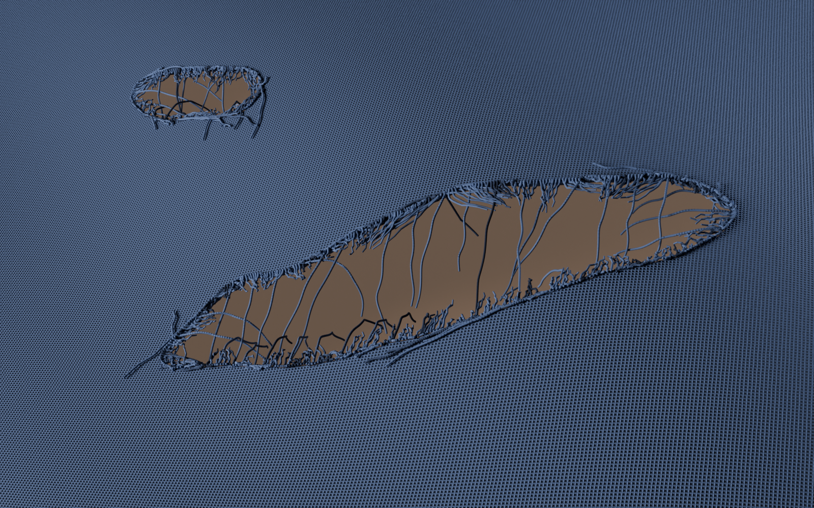
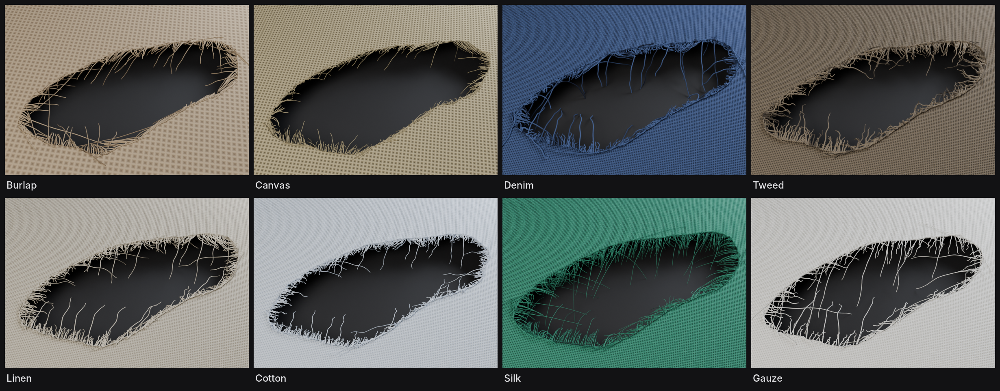
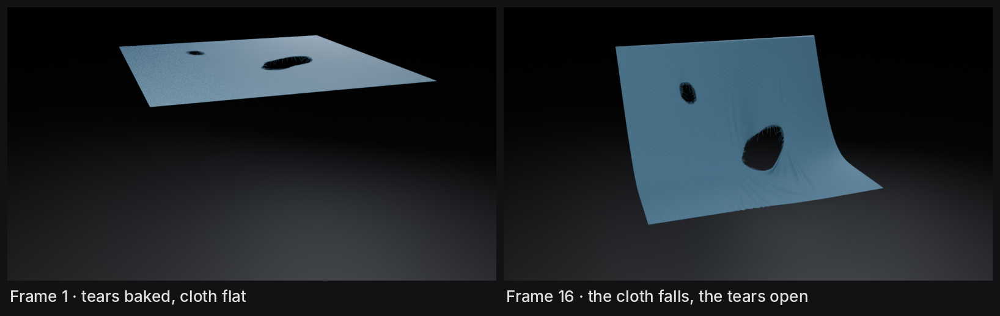
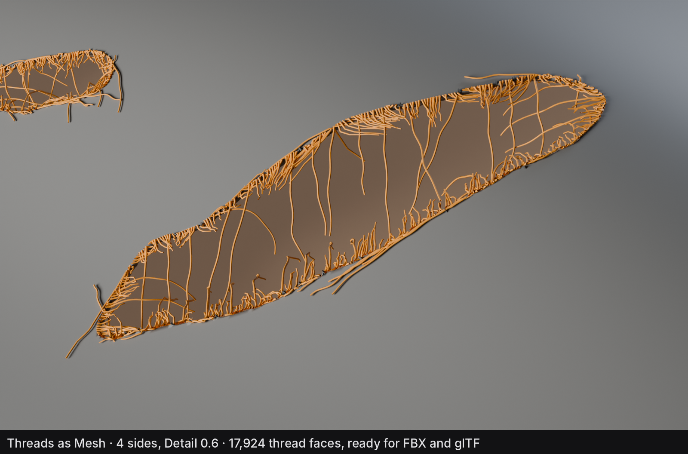

# Unravel# Unravel

**Tear holes in cloth and grow frayed threads around them.** A Blender 5.2 extension built on Geometry Nodes.

## Features

- **Paint your tears.** Paint red on the cloth and holes open up with ragged, thick edges.
- **Two layers of threads.** Short dense fray along every edge, plus long loose strays, with controls for curl, frizz, clumping, droop and bridges.
- **Hand-drawn strands.** Draw your own loose threads right on the cloth.
- **8 cloth presets.** Burlap, Canvas, Denim, Tweed, Linen, Cotton, Silk and Gauze.
- **Ready for simulation and rigs.** Bake Tears cuts the holes into the mesh, and the threads follow the moving cloth.
- **Ready for export.** Apply Unravel turns everything into plain mesh or hair for FBX, glTF, Alembic and USD.
- **Non-destructive.** Your paint is never touched, and Restore brings the live setup back after applying.

## Install

1. Download `unravel-1.0.0.zip` from [Releases](https://github.com/paraminder-dhiman/unravel/releases).
2. In Blender, go to **Edit ▸ Preferences ▸ Get Extensions**.
3. Click the **⌄** arrow in the top-right corner, choose **Install from Disk…** and pick the zip.

Requires **Blender 5.2** or newer.

## Quick start

1. Select a cloth mesh. It needs UVs for the threads to follow the weave.
2. Right-click in the viewport and choose **Make Unravel** (or use the **Unravel** tab in the N sidebar).
3. Click **Paint Tears** and paint red where the cloth should tear.
4. Click **Done Painting**. Holes, thick edges and threads appear.
5. Try a look from **Presets**, then fine-tune in the Unravel tab.

Unravel expects real-world size (1 unit = 1 metre). If your cloth is a different size, set **Scale** in the Unravel tab.

The **?** button in the Unravel tab opens the full guide.

## Presets

## Simulation

Click **Bake Tears** before you simulate or rig the cloth. The holes are cut into the mesh so the cloth flaps around them, while the thickness, threads and strands stay live and follow it. **Unbake Tears** brings the live tears back for editing.

## Export

**Apply Unravel** (at the bottom of the main panel) turns the cloth and threads into plain objects at the current frame:

- **Threads as Mesh:** thin tubes for FBX, glTF and game engines. Sides and Detail set the weight.
- **Threads as Hair:** hair curves for Blender, Alembic and USD.
- **Rigged cloth:** the thread mesh takes the cloth's bone weights, so it bends with the rig.

**Restore Unravel** brings the live setup back. For animated cloth there's no need to apply: export the live scene to Alembic.

## Known limits

- FBX and glTF don't carry hair curves. Use **Threads as Mesh** for those formats.
- Threads applied as Hair keep a single material.
- Draw strands while the cloth is in its resting shape (frame 1).

## License

GPL-3.0-or-later. © 2026 Paraminder Dhiman.