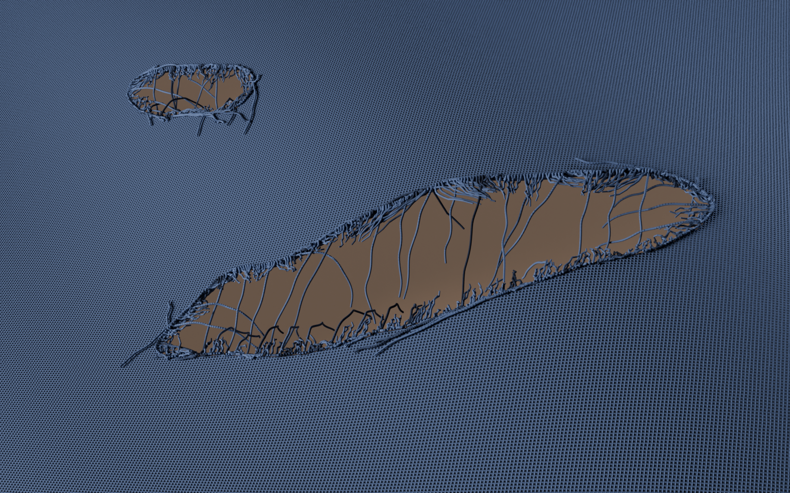
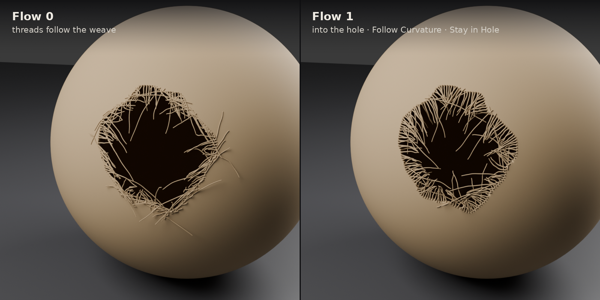
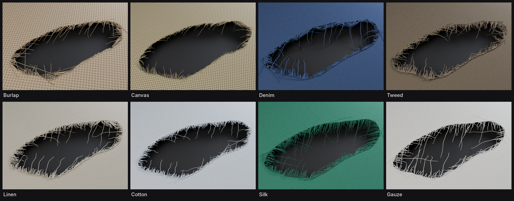
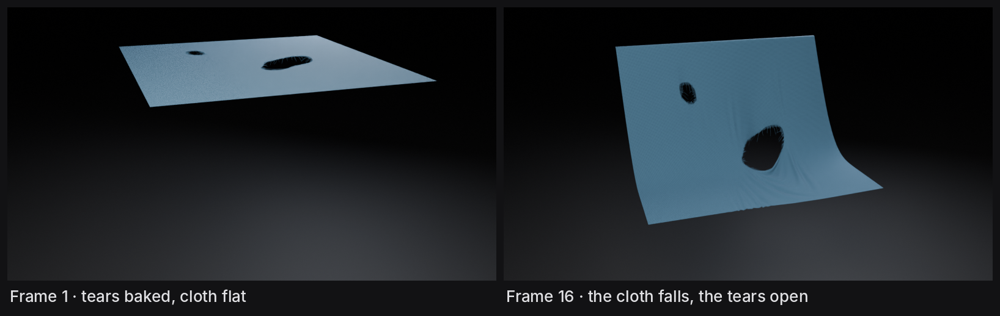
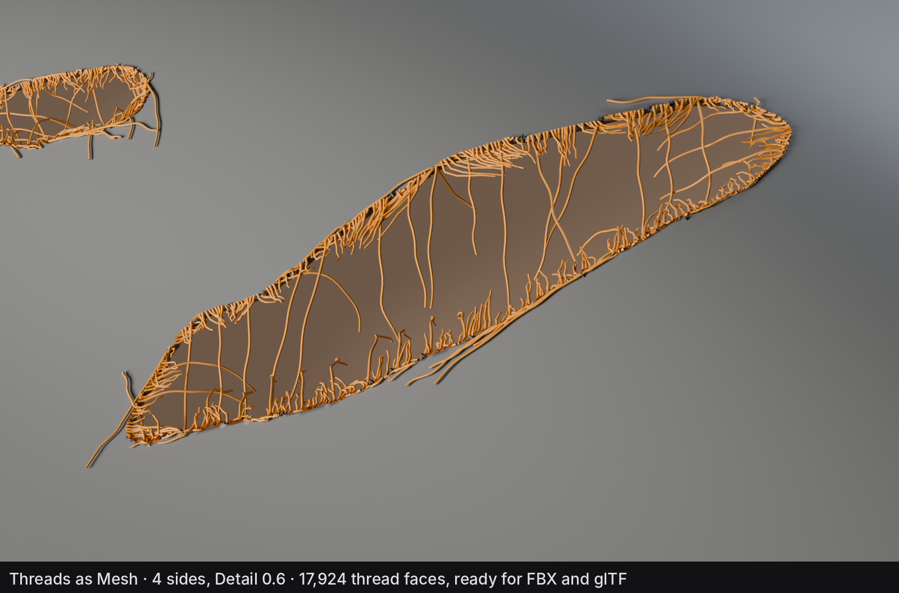

# Unravel

**Tear holes in cloth and grow frayed threads around them.** A Blender 5.2 extension built on Geometry Nodes.

## Features

- **Paint your tears.** Paint red on the cloth and holes open up with ragged, thick edges.
- **Holes you already modelled.** Detect Holes gives existing holes torn edges and threads with no painting, and leaves the mesh's own hems and openings alone.
- **Threads that flow into the hole.** Flow points threads into the tear, Follow Curvature bends them along the cloth's surface, and Stay in Hole keeps them from poking out the far side.
- **Two layers of threads.** Short dense fray along every edge, plus long loose strays, with controls for curl, frizz, clumping (including tufts that fan out), droop and bridges.
- **Hand-drawn strands.** Draw your own loose threads right on the cloth.
- **8 cloth presets.** Burlap, Canvas, Denim, Tweed, Linen, Cotton, Silk and Gauze.
- **Ready for simulation and rigs.** Bake Tears cuts the holes into the mesh, and the threads follow the moving cloth.
- **Ready for export.** Apply Unravel turns everything into plain mesh or hair for FBX, glTF, Alembic and USD.
- **Non-destructive.** Your paint is never touched, and Restore brings the live setup back after applying.

## Install

1. Download `unravel-1.1.0.zip` from [Releases](https://github.com/paraminder-dhiman/unravel/releases), or install it from [Blender Extensions](https://extensions.blender.org/add-ons/unravel/).
2. In Blender, go to **Edit ▸ Preferences ▸ Get Extensions**.
3. Click the **⌄** arrow in the top-right corner, choose **Install from Disk…** and pick the zip.

Requires **Blender 5.2** or newer.

## Quick start

1. Select a cloth mesh. With UVs, threads can also follow the weave.
2. Right-click in the viewport and choose **Make Unravel** (or use the **Unravel** tab in the N sidebar).
3. Click **Paint Tears** and paint red where the cloth should tear. Holes that are already in the mesh? Tick **Detect Holes** instead.
4. Click **Done Painting**. Holes, thick edges and threads appear.
5. Try a look from **Presets**, then fine-tune in the Unravel tab.

Unravel expects real-world size (1 unit = 1 metre). If your cloth is a different size, set **Scale** in the Unravel tab.

The **?** button in the Unravel tab opens the full guide.

**Updating from 1.0?** Open your file and click **Update Node Groups** at the top of the Unravel tab. Your settings and paint are kept, and the new options start switched off, so the file looks the same until you change them.

## Direction

Each thread layer has a **Direction** group:

- **Flow:** 0 follows the weave of the cloth, 1 points the threads into the hole.
- **Aim:** **Across Edge** points each thread straight into the hole from where it grows, and works for any shape. **Toward Centre** points threads at the middle of their hole, and looks tidiest on round holes.
- **Follow Curvature:** bends threads along the surface the cloth would have had, so they don't stick out from sleeves or clip into what the cloth wraps.
- **Stay in Hole:** shortens threads that would reach past the far side of their hole.

## Existing holes

Tick **Detect Holes** in the Tears panel and holes that are already in the mesh get torn edges and threads, without painting. Their outlines stay exactly as modelled. **Ignore Boundaries** leaves the mesh's own outer edges alone (hems, cuffs, necklines): open loops longer than **Boundary Size** count as outer edges, and Boundary Size is set for you from the mesh. To change a single hole, select an edge on its border in Edit Mode and use **Mark as Tear** or **Clear Tear**.

## Presets

## Simulation

Click **Bake Tears** before you simulate or rig the cloth. The holes are cut into the mesh so the cloth flaps around them, while the thickness, threads and strands stay live and follow it. **Unbake Tears** brings the live tears back for editing.

## Export

**Apply Unravel** (at the bottom of the main panel) turns the cloth and threads into plain objects at the current frame:

- **Threads as Mesh:** thin tubes for FBX, glTF and game engines. Sides and Detail set the weight.
- **Threads as Hair:** hair curves for Blender, Alembic and USD.
- **Rigged cloth:** the thread mesh takes the cloth's bone weights, so it bends with the rig.

**Restore Unravel** brings the live setup back. For animated cloth there's no need to apply: export the live scene to Alembic.

## Known limits

- FBX and glTF don't carry hair curves. Use **Threads as Mesh** for those formats.
- Threads applied as Hair keep a single material.
- Draw strands while the cloth is in its resting shape (frame 1).
- Thread width only shows in **Material Preview** and **Rendered** view. Solid view draws threads as thin lines.
- Detect Holes guesses the outer edges from loop sizes. If a hem is counted as a hole (or the other way round), adjust **Boundary Size** or use **Mark as Tear** / **Clear Tear**.
- Toward Centre can aim some threads over the cloth on long, bent tears. Across Edge suits those better.

## License

GPL-3.0-or-later. © 2026 Paraminder Dhiman.