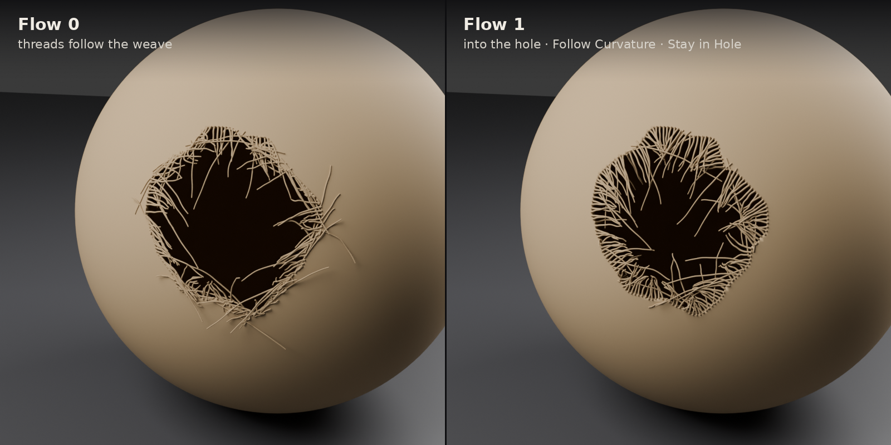

Unravel 1.1 is shaped by feedback from an artist using it on sculpted cloth. Threads now flow into the tear, holes already in the mesh can be frayed without painting, and torn edges hold up on triangulated meshes.

**Download** `unravel-1.1.0.zip` below and install it from **Edit ▸ Preferences ▸ Get Extensions ▸ ⌄ ▸ Install from Disk…**, or update it from Blender Extensions.

### New
- **Direction** for each thread layer:
  - **Flow** turns threads from the weave into the hole
  - **Aim** points them straight across the edge or toward the hole's centre
  - **Follow Curvature** bends them along the cloth's surface
  - **Stay in Hole** stops them before the far side
- **Detect Holes** gives holes already in the mesh torn edges and threads, with no painting. Their outlines stay exactly as modelled.
  - **Ignore Boundaries** leaves hems, cuffs and necklines alone
  - **Mark as Tear** and **Clear Tear** in Edit Mode fix single holes
- **Negative Clumping** gathers thread roots into tufts that fan out, like grass.
- **Meshes without UVs** grow threads too, when Flow is above 0.

### Improved
- **Threads panel:** threads have their own section, and each layer's settings sit in groups you can open and close (Shape, Direction, Style, Bridges, Surface Contact).
- **Clean cutting:** spikes, pinched corners and tiny loose bits left by cutting are cleaned up for you, even on triangle meshes.
- **Thickness:** eases off on tight curves, so the edge can't fold through itself.
- **Presets:** all eight use the new direction settings.

### Fixed
- **Droop and Bridge Sag** now fall world down on rotated cloth, such as ZBrush imports.
- **Thread width** is capped at 2 cm, and the panel explains that Solid view always draws threads as thin lines (see width in Material Preview or Rendered).

### Updating from 1.0
Open your file and click **Update Node Groups** at the top of the Unravel tab. Settings and paint are kept, and the new options start switched off, so the file looks the same until you change them.

### Good to know
- **Detect Holes** guesses outer edges from loop sizes. If it gets one wrong, adjust **Boundary Size** or use Mark as Tear / Clear Tear.
- **Toward Centre** can aim some threads over the cloth on long, bent tears. Across Edge suits those better.
